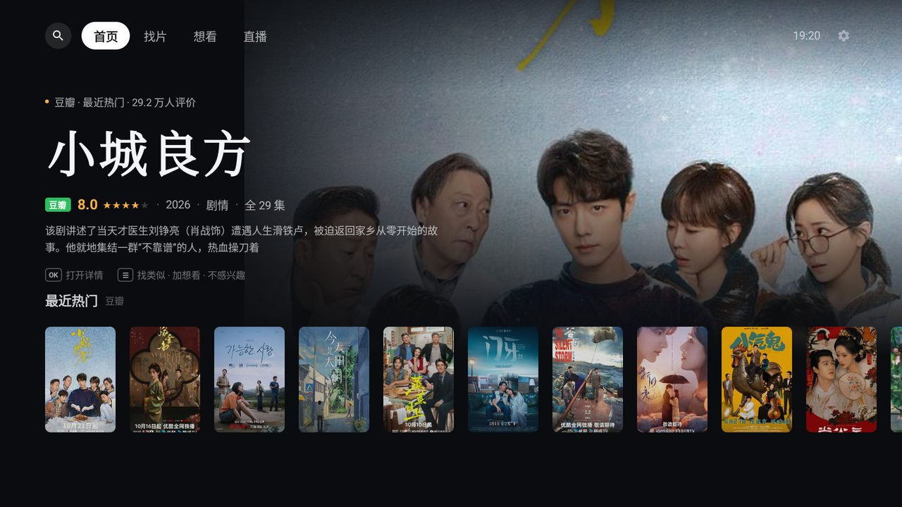
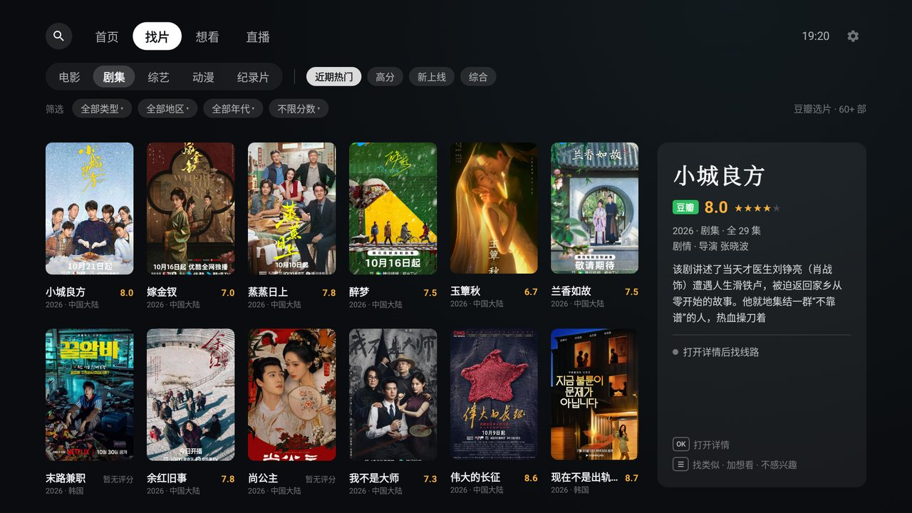
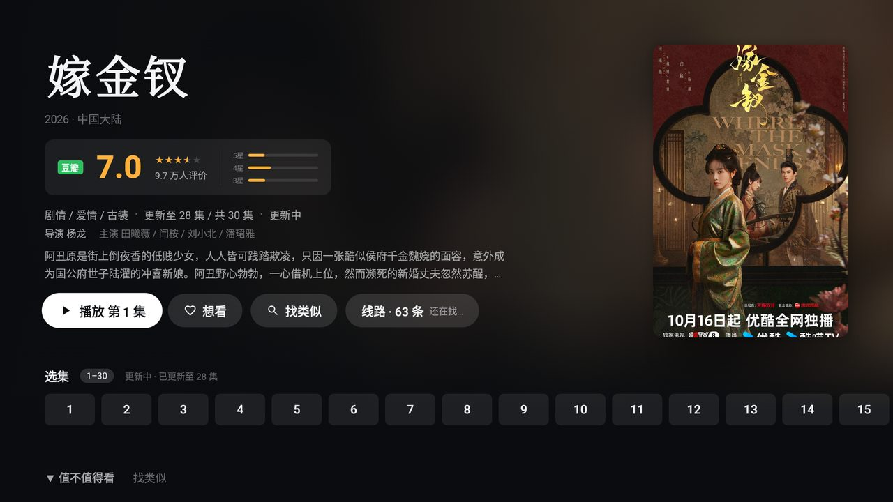
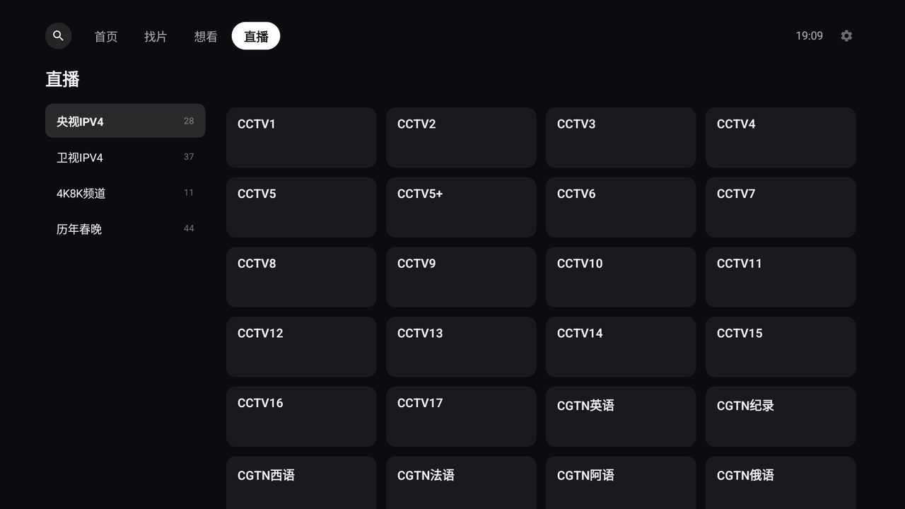
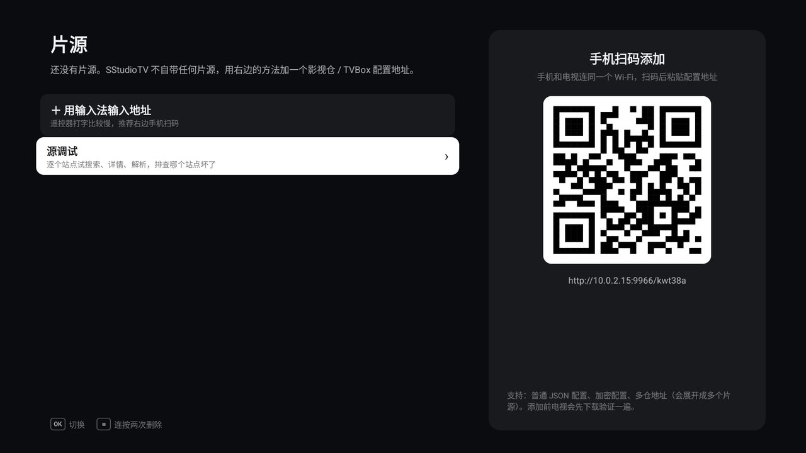

# SStudioTV

给电视用的观影 App：**豆瓣负责「看什么」，影视仓 / TVBox 配置负责「在哪看」**。

首页、找片、搜索全部来自豆瓣：海报、评分、简介、找类似。选好片以后，App 拿片名去你配置里的所有站点并发搜索，把能播的线路合在一起，自动挑一条能放的。直播频道也来自同一个配置。

> SStudioTV **不自带任何片源**，也不提供任何影视内容。第一次打开需要你自己添加一个影视仓 / TVBox 配置地址。

| 首页 | 找片 |
| --- | --- |
|  |  |
| **详情 · 线路** | **直播** |
|  |  |
| **片源（手机扫码添加）** | |
|  | |

## 功能

- **豆瓣首页 / 找片**：最近热门、继续观看；按类型 × 地区 × 年代 × 评分筛选，结果本地缓存，翻页不卡
- **全量搜索**：一万多部豆瓣片名的本地索引，支持中文和拼音首字母（`ZHZ` → 甄嬛传），每 7 天后台更新
- **线路合并**：一部片在配置的所有站点里并发找，直链优先、失败过的靠后、集数全的靠前；播放出错或卡住自动换下一条
- **线路偏好**：设置里把站点标成「优先」或「不用」，播放时先试优先的
- **站点类型**：CMS JSON（type 1）、CMS XML（type 0）、jar 插件站点（type 3，在独立进程里跑，崩了不影响主界面）
- **解析**：`parse=1` 的线路走配置里的解析接口，或者用 WebView 嗅探出真实地址
- **直播**：配置里的 `lives`，txt 和 m3u 都认；↑↓ 换台、←→ 换信号，一个信号挂了自动试下一个
- **片源管理**：手机扫码，在手机上粘贴地址发到电视；也能用电视输入法输入。支持加密配置和多仓地址
- **夜间音量**：压缩动态范围，爆炸声不炸、对白不小
- **想看**：只存在这台电视上，不需要登录豆瓣

暂不支持：drpy / JS 站点、Python 站点。

## 安装

到 [Releases](../../releases) 下载 APK，用 U 盘或者 `adb install` 装到电视上。最低 Android 6.0。

装好后：**设置 → 片源**，手机扫屏幕上的二维码（手机和电视要连同一个 Wi-Fi），粘贴配置地址，提交。

## 自己出包

需要 JDK 17、Android SDK 35。

```bash
./gradlew assembleDebug      # app/build/outputs/apk/debug/app-debug.apk
./gradlew assembleRelease    # 没配签名时用 debug 签名
```

**签名（可选）**：新建 `signing/keystore.properties`：

```properties
storeFile=my-release.jks
storePassword=…
keyAlias=…
keyPassword=…
```

把 keystore 放在 `signing/` 下。这个目录已经被 `.gitignore` 忽略了。

**预置片源（可选，自用）**：放一个 `app/src/main/assets/presets.json`，首次启动会自动导入：

```json
[{ "name": "我的源", "url": "http://…" }]
```

**种子搜索索引（可选）**：不放的话，App 第一次启动会在后台花几分钟从豆瓣建索引，建完之前只能搜到热门。想装完就能搜全量，可以在一台已经建好索引的设备上导出来，再打进包里：

```bash
adb shell run-as com.sstudio.piandan cat files/search-index.json > app/src/main/assets/search-seed.json
```

## 代码结构

```
app/src/main/java/dev/personal/tv/
├── data/      豆瓣接口、片库缓存、搜索索引、拼音首字母、本地存储
├── source/    配置解析、站点（CMS / XML / 插件）、线路查找、解析与嗅探、直播、片源管理、局域网添加
├── spider/    jar 插件站点的独立进程
├── audio/     夜间音量（动态压缩）
└── ui/        Compose for TV 页面和组件
```

## 免责声明

本项目只是一个播放器外壳，仅供学习交流。它不内置、不提供、不推荐任何片源或影视内容。用户自行添加的配置和内容与本项目无关，请遵守所在地的法律法规，支持正版。

影片信息和海报来自豆瓣，版权归原作者所有。

## License

[MIT](LICENSE)
