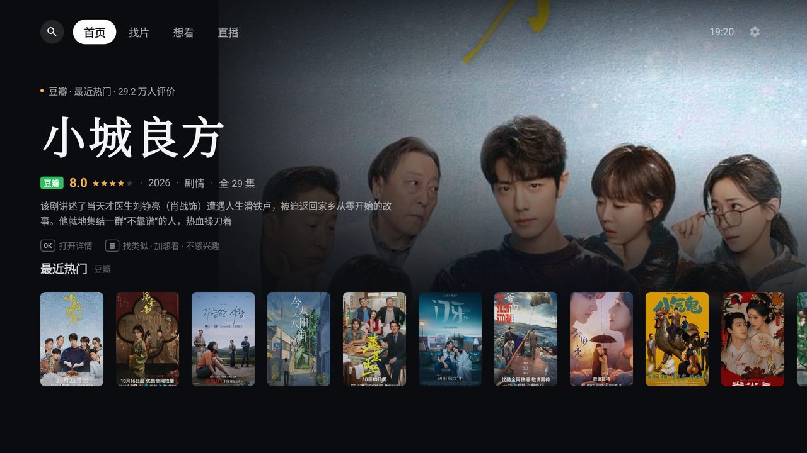
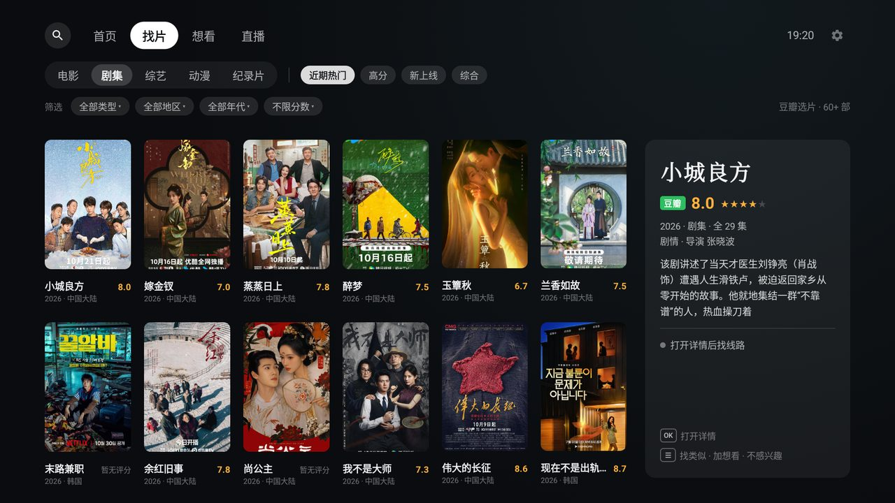
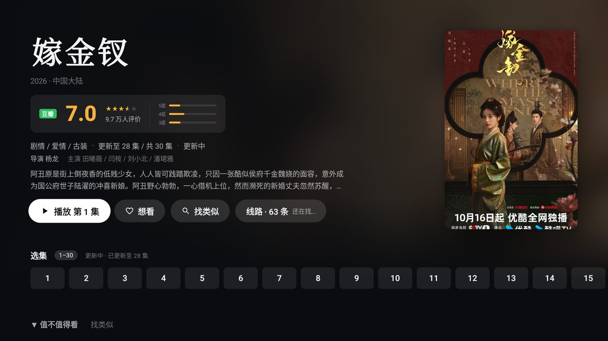
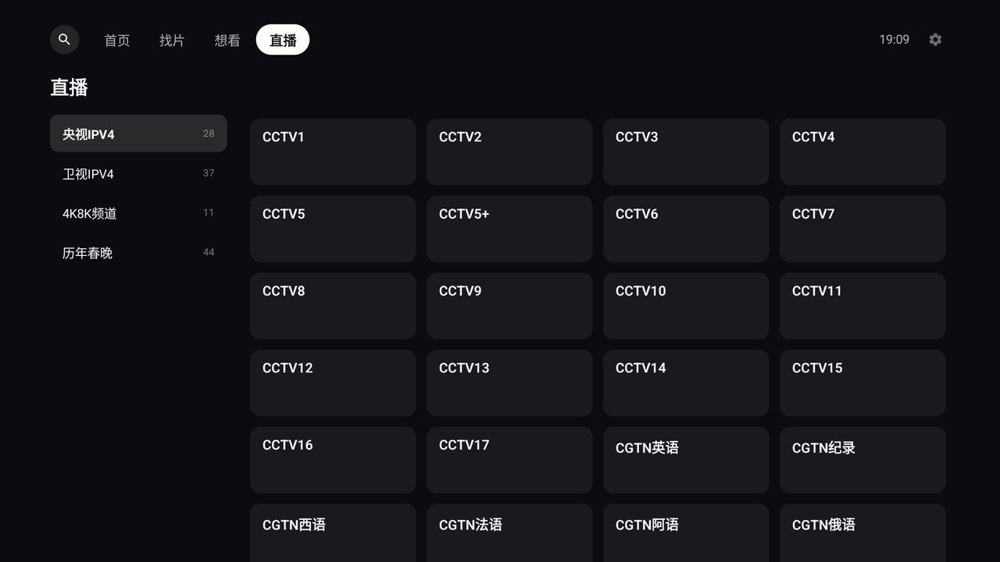
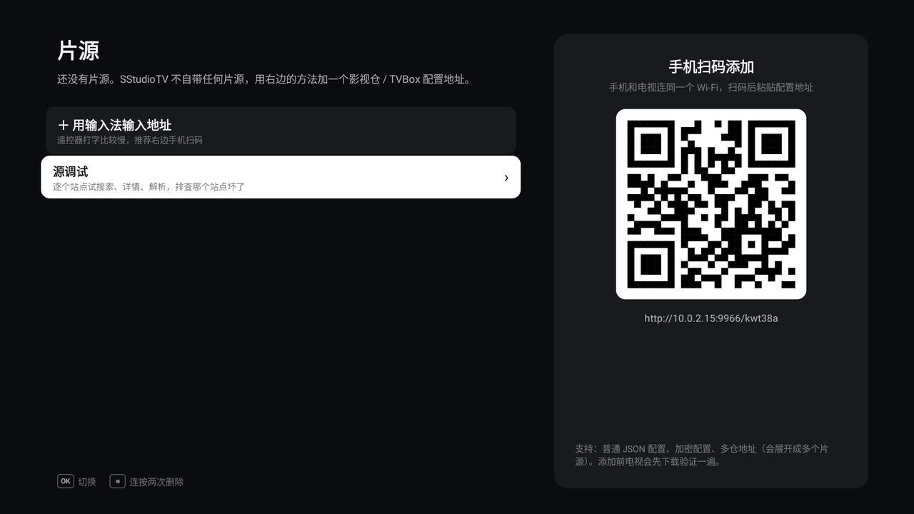

# SStudioTV

给电视用的观影 App：**豆瓣负责「看什么」，影视仓 / TVBox 配置负责「在哪看」**。

首页、找片、搜索都以豆瓣为主：海报、评分、简介、找类似。选好片以后，App 拿片名去你配置里的所有站点并发搜索，把能播的线路合在一起，自动挑一条能放的。直播频道也来自同一个配置。电视和手机 / 平板都能用，手机上是单独的触屏界面。

> SStudioTV **不自带任何片源**，也不提供任何影视内容。第一次打开需要你自己添加一个影视仓 / TVBox 配置地址。

| 首页 | 找片 |
| --- | --- |
|  |  |
| **详情 · 线路** | **直播** |
|  |  |
| **片源（手机扫码添加）** | |
|  | |

## 功能

**找片**
- **豆瓣首页 / 找片**：最近热门、继续观看；按类型 × 地区 × 年代 × 评分筛选，结果本地缓存，翻页不卡
- **逛站点**：找片页里豆瓣下面就是当前配置的各个站点，可以逛它们的首页、分类和文件夹。从站点点开的片先用这个站自己的分集，短剧、B 站、网盘分享这类按片名配不上的也能播
- **全量搜索**：一万多部豆瓣片名的本地索引，支持中文和拼音首字母（`ZHZ` → 甄嬛传），每 7 天后台更新；用输入法打字时查全部豆瓣，英文原名也认（`gentleman` → 绅士们）。豆瓣上没有、片源里有的片子也能搜到
- **想看**：只存在这台设备上，不需要登录豆瓣

**找线路、播放**
- **线路合并**：一部片在配置的所有站点里并发找，直链优先、失败过的靠后、集数全的靠前；解析不出、播放出错或卡住 20 秒自动换下一条（可关）
- **跨片源补搜**：当前配置没有这部、集数落后、还在更新、只有抢先版，或者电影没有 1080 时，再去你加过的其它配置里的采集站补搜，只留集数更多或画质更好的线路（可关）
- **继续观看**：接着上次那条线路和位置放；换线路、自动换线、重试都从原来的位置接着放
- **按分集名选集**：综艺按片源里的名字排（「11.01 上」「加更版」），集数多的分组显示；换线路时按名字找同一期，电视剧按「第几集」找，线路里夹着花絮也不会错位
- **预缓存**：播起来 15 秒后，后台把这一集后面的部分和下一集存好，网慢也不卡；用流量时不存（可关）
- **线路偏好**：设置里把站点标成「优先」或「不用」，播放时先试优先的
- **夜间音量**：压缩动态范围，爆炸声不炸、对白不小

**插件和网盘**
- **站点类型**：CMS JSON（type 1）、CMS XML（type 0）、jar 插件站点（type 3，在独立进程里跑，插件崩了不影响主界面，进程挂了马上重启）
- **解析**：`parse=1` 的线路走配置里的解析接口，或者用 WebView 嗅探出真实地址
- **网盘登录**：夸克、UC、百度、115 等每家单独扫码登录；插件自带的设置页（扫码、填 Cookie）也能直接打开。没登录的网盘线路排到后面，不会卡着等超时
- **插件提示不刷屏**：后台搜线路时插件弹的「资源失效」、广告这类提示不弹；跟登录有关的照样提醒，并记在「设置 → 网盘登录」里

**直播**
- 配置里的 `lives`，txt 和 m3u 都认；↑↓ 换台、←→ 换信号，一个信号挂了自动试下一个

**手机 / 平板**
- 装在手机或平板上自动换成触屏界面：首页、找片、直播、想看、我的
- 横屏播放：滑动调进度、亮度、音量，双击快退快进，选集、换线路、倍速、锁屏
- **离线下载**：详情页选线路、选集，后台下载（默认只用 Wi-Fi）；下好的集播放时先放本地，没网也能看

**其它**
- **片源管理**：手机扫码，在手机上粘贴地址发到电视；也能用电视输入法输入。支持加密配置和多仓地址
- **文字、海报大小**：设置里连续调，边调边看效果，4K 电视上也不会字太小
- **自动更新**：启动时看一下 GitHub 上有没有新版（12 小时一次），设置里一键下载安装；连 GitHub 慢时自动换镜像。请求里只带版本号。升级不影响片源、观看记录和设置

暂不支持：drpy / JS 站点、Python 站点。

## 安装

到 [Releases](../../releases) 下载 APK，用 U 盘或者 `adb install` 装到电视上，手机直接装。最低 Android 6.0。之后的版本可以在 App 里升级：**设置 → 版本 → 检查更新**。

装好后：**设置 → 片源**，手机扫屏幕上的二维码（手机和电视要连同一个 Wi-Fi），粘贴配置地址，提交。

## 自己出包

需要 JDK 17、Android SDK 35。

```bash
./gradlew assembleDebug      # app/build/outputs/apk/debug/app-debug.apk
./gradlew assembleRelease    # 没配签名时用 debug 签名
```

**签名（可选）**：新建 `signing/keystore.properties`：

```properties
storeFile=my-release.jks
storePassword=…
keyAlias=…
keyPassword=…
```

把 keystore 放在 `signing/` 下。这个目录已经被 `.gitignore` 忽略了。

**预置片源（可选，自用）**：放一个 `app/presets/presets.json`（已被 `.gitignore` 忽略），启动时会把没导过的导进来。编译时加 `-Ppublic`（`./gradlew assembleRelease -Ppublic`）出的包不带它：

```json
[{ "name": "我的源", "url": "http://…" }]
```

**种子搜索索引（可选）**：不放的话，App 第一次启动会在后台花几分钟从豆瓣建索引，建完之前只能搜到热门。想装完就能搜全量，可以在一台已经建好索引的设备上导出来，再打进包里：

```bash
adb shell run-as com.sstudio.piandan cat files/search-index.json > app/src/main/assets/search-seed.json
```

## 代码结构

```
app/src/main/java/dev/personal/tv/
├── data/       豆瓣接口、片库缓存、搜索索引、拼音首字母、继续观看、本地存储
├── source/     配置解析、站点（CMS / XML / 插件）、线路查找与跨片源补搜、解析与嗅探、直播、
│               片源管理、局域网添加、网盘登录、自动更新
├── spider/     jar 插件站点的独立进程、插件设置页、插件提示
├── media/      播放缓存（预缓存）、离线下载
├── audio/      夜间音量（动态压缩）
└── ui/
    ├── screens/   电视界面（Compose for TV）和播放会话
    └── phone/     手机 / 平板触屏界面
```

## 免责声明

本项目只是一个播放器外壳，仅供学习交流。它不内置、不提供、不推荐任何片源或影视内容。用户自行添加的配置和内容与本项目无关，请遵守所在地的法律法规，支持正版。

影片信息和海报来自豆瓣，版权归原作者所有。

## License

[MIT](LICENSE)
